# trino-hive-docker
trino + hive + minio with postgres in docker compose


# Trino-Hive-Postgres-Minio Exercise

This is a personal exercise for me to understand Trino and its architecture, especially with 
Hive Metastore/ Postgres/ Minio. The idea of the exercise is originated from 
https://trino.io/blog/2020/10/20/intro-to-hive-connector.html. The only difference is that I 
changed the DB of Hive Metastore from MariaDB to PostgresDB and tried to implement it 
with k8s with the help of https://github.com/alexcpn/presto_in_kubernetes.

## Architechure Diagram


## Run Locally with Docker-compose
The implementation with docker-compose is referred to https://github.com/bitsondatadev/trino-getting-started/tree/main/hive/trino-minio 
with the help of https://github.com/bitsondatadev/hive-metastore/pull/2/commits to build a Hive Metastore image to
support PostgresDB.

OPEN DOCKER DESKTOP AND RUN THE FOLLOWING COMMANDS IN YOUR TERMINAL:
Step 0 - Go to the docker-compose directory
```bash
cd docker-compose
```
Step 1 - Build a Hive Metastore image with the Dockerfile to support PostgresDB
```bash
docker build -t my-hive-metastore .
```
Step 2 - Implement with docker-compose
```bash
docker-compose up -d
```
Step 3 - Check if a Bucket in MinIO is created
- account: minio
- password: minio123

with name "warehouse", the minio-init in docker compose will do it automatically.

Step 4 - Into the runnung trino container
```bash
docker container exec -it docker-compose-trino-coordinator-1 trino
```
IF TRINO . IS REPLACED WITH N JUST USE POWERSHELL

```bash

trino> SHOW CATALOGS;
 Catalog
---------
 hive               ## contains the Hive Metastore connector
 iceberg            ## contains the Iceberg connector
 system
 tpcds
 tpch
(5 rows)

Query 20260507_194548_00019_dmrzi, FINISHED, 1 node
Splits: 19 total, 19 done (100.00%)
0.23 [0 rows, 178B] [0 rows/s, 777B/s]


trino> SHOW SCHEMAS FROM iceberg;
       Schema
--------------------
 default
 demographics
 hr                          ## we will use this as example
 information_schema
 mobility
 raw_demographics
 raw_hr
 raw_mobility
 system
(9 rows)

Query 20260507_194557_00020_dmrzi, FINISHED, 1 node
Splits: 19 total, 19 done (100.00%)
0.23 [9 rows, 464B] [38 rows/s, 1.94KiB/s]


trino> SHOW TABLES FROM iceberg.hr;       # verify the tables in hr schema
Table
-----------
employees                             # only one table in hr schema
(1 row)

Query 20260507_105700_00009_gmscr, FINISHED, 1 node
Splits: 19 total, 19 done (100.00%)
0.23 [1 rows, 133B] [4 rows/s, 591B/s]


trino> SELECT * FROM iceberg.hr.employees LIMIT 10;  ## check the data in employees table
 age | attrition |  businesstravel   | dailyrate |       department       | distancefromhome | education | employeecoun>
-----+-----------+-------------------+-----------+------------------------+------------------+-----------+------------->
  41 | Yes       | Travel_Rarely     |      1102 | Sales                  |                1 |         2 |          NUL>
  33 | No        | Travel_Frequently |      1392 | Research & Development |                3 |         4 |          NUL>
  27 | No        | Travel_Rarely     |       591 | Research & Development |                2 |         1 |          NUL>
  32 | No        | Travel_Frequently |      1005 | Research & Development |                2 |         2 |          NUL>
  59 | No        | Travel_Rarely     |      1324 | Research & Development |                3 |         3 |          NUL>
  49 | No        | Travel_Frequently |       279 | Research & Development |                8 |         1 |          NUL>
  37 | Yes       | Travel_Rarely     |      1373 | Research & Development |                2 |         2 |          NUL>
  30 | No        | Travel_Rarely     |      1358 | Research & Development |               24 |         1 |          NUL>
  38 | No        | Travel_Frequently |       216 | Research & Development |               23 |         3 |          NUL>
  36 | No        | Travel_Rarely     |      1299 | Research & Development |               27 |         3 |          NUL>
(10 rows)
(END)
```


### Execute Trino sql command with other username
```bash
docker exec -it docker-compose-trino-coordinator-1 trino --user alice
```
it will open a trino CLI with user alice, then you can run the same sql command to create schema and table. You can also check the trino dashboard to see the query history with different users.
```text
>trino
```
and paste:
```sql
SHOW SCHEMAS;
```
You will get the following result:
```text
 Query 20260507_075237_00004_wytmq failed: Access Denied: Cannot execute query
```


### CREATE DATASET with AI not compliant with GDPR
https://www.mockaroo.com/?utm_source=chatgpt.com
### (Optional: see the metadata store in Postgres)
Step 6 - Into the running postgres container
```bash 
docker exec -it "docker-compose_postgres_1" psql -U admin -d "hive_db"
```
Step 7 - Run SQL commands on postgresDB to see where the metadata is stored. 
```sql
SELECT
 "DB_ID",
 "DB_LOCATION_URI",
 "NAME", 
 "OWNER_NAME",
 "OWNER_TYPE",
 "CTLG_NAME"
FROM "DBS";
```

For more metadata detail, kindly check: 
https://github.com/bitsondatadev/trino-getting-started/tree/main/hive/trino-minio

Step 8 - Close down the running containers
```bash
docker-compose down
```

# Trino and OPA
```text
Analyst runs query
│
▼
Trino Engine
│
├──▶ Access control check (SelectFromColumns)
│         │
│         ├── Synapse looks up user attributes (dept, clearance)
│         ├── OPA evaluates: ALLOW
│         └── Returns {"result": true}
│
├──▶ Row filter check
│         │
│         ├── Looks up user attributes
│         ├── OPA evaluates GetRowFilter
│         └── Returns: clearance IN ('public', 'internal')
│
└──▶ Column masking check
        │
        ├── Checks each column against policy
        ├── email → partial mask (first 2 chars visible)
        ├── phone → last 4 digits only
        ├── clearance → [REDACTED] (analyst lacks confidential clearance)
        └── other columns → pass through
```
## TRINO-OPA input.action.operation mapping with SQL request

Every SELECT triggers 3 operations in sequence: ExecuteQuery → GetColumnMask (once per column) → GetRowFilters (once per table) → SelectFromColumns. You can see this exact pattern in your own logs.
GetColumnMask is called even for columns you don't mask — OPA just returns {} for those, which means "no mask". Only when you return {"result": {"expression": "..."}} does Trino apply it.

# OPA Role base access control

## Example 
Grant access to human resources manager to its database
etc/access-control.properties
```properties
access-control.name=opa
opa.policy.uri=http://opa:8181/v1/data/trino/authz/allow
# Row filtering
opa.policy.row-filters-uri=http://opa:8181/v1/data/trino/authz/rowFilters
# Column filtering
opa.policy.column-masking-uri=http://opa:8181/v1/data/trino/authz/columnMask
# Batch Column
opa.policy.batch-column-masking-uri=http://opa:8181/v1/data/trino/authz/batchColumnMasks
# Batch mode, granting access to multiple resources without asking for each resource but sending a single msg
opa.policy.batched-uri=http://opa:8181/v1/data/trino/authz/batch

# avoid allowing users to manage permissions via OPA policies
opa.allow-permission-management-operations=false
```
opa/policy.rego
```rego
package trino.authz

import future.keywords.in
import future.keywords.if
import future.keywords.contains

# ============================================================
# ROLE DEFINITION
# ============================================================

# analyst_operation groups the three operations that Trino fires
# during every SELECT query:
#   - SelectFromColumns : checks if the user can read those columns
#   - GetColumnMask     : asks OPA if any column should be masked
#   - GetRowFilters     : asks OPA if any row-level filter applies
# These are kept separate from navigation ops because they carry
# resource.table (not resource.catalog or resource.schema).
analyst_operation := {
    "SelectFromColumns",
    "GetColumnMask",
    "GetRowFilters"
}
# define the hr groups 
is_hr if {
    input.context.identity.user in {"alice", "mario"}
}

# ============================================================
# 1. QUERY EXECUTION
# ============================================================

# ExecuteQuery is fired before any SQL is planned — it carries
# no resource at all. It must be allowed standalone, otherwise
# every query is denied before Trino even inspects the tables.
allow if {
    is_hr
    input.action.operation == "ExecuteQuery"
}

# ============================================================
# 2. CATALOG ACCESS
# ============================================================

# AccessCatalog is the hard gate: Trino checks this before
# allowing any interaction with the catalog. Denying it produces
# an explicit "Access Denied" error.
allow if {
    is_hr
    input.action.operation == "AccessCatalog"
    input.action.resource.catalog.name == "iceberg"
}

# FilterCatalogs is the soft gate: Trino calls this when building
# result sets for SHOW CATALOGS. Denying it silently hides the
# catalog from listings without producing an error. Both
# AccessCatalog and FilterCatalogs are needed — one for hard
# access control, one for visibility in listings.
allow if {
    is_hr
    input.action.operation == "FilterCatalogs"
    input.action.resource.catalog.name == "iceberg"
}

# ============================================================
# 3. SCHEMA NAVIGATION
# ============================================================

# ShowSchemas is the hard gate for SHOW SCHEMAS FROM iceberg.
# Note: resource here is resource.catalog (the parent level),
# not resource.schema — Trino hasn't resolved the schema yet.
allow if {
    is_hr
    input.action.operation == "ShowSchemas"
    input.action.resource.catalog.name == "iceberg"
}

# FilterSchemas is the soft gate called per-schema to decide
# what appears in SHOW SCHEMAS results. By allowing only "hr"
# here, alice sees only the hr schema in listings even though
# other schemas exist. Other schemas are silently hidden.
allow if {
    is_hr
    input.action.operation == "FilterSchemas"
    input.action.resource.schema.catalogName == "iceberg"
    input.action.resource.schema.schemaName == "hr"
}

# AccessSchema is required when Trino resolves a schema reference
# in a query (e.g. USE iceberg.hr or any query targeting hr).
# information_schema also needs this because SHOW TABLES, SHOW
# COLUMNS, and DESCRIBE all internally query information_schema.
allow if {
    is_hr
    input.action.operation == "AccessSchema"
    input.action.resource.schema.catalogName == "iceberg"
    input.action.resource.schema.schemaName in {"hr", "information_schema"}
}

# SelectFromColumns on information_schema is needed because SHOW
# TABLES / SHOW COLUMNS / DESCRIBE are rewritten internally by
# Trino as SELECT queries against information_schema system
# tables (e.g. information_schema.tables, .columns). Without
# this, those commands return "Access Denied: Cannot select
# from columns" even if ShowTables is allowed.
allow if {
    is_hr
    input.action.operation == "SelectFromColumns"
    input.action.resource.table.catalogName == "iceberg"
    input.action.resource.table.schemaName == "information_schema"
}

# ============================================================
# 4. TABLE LISTING
# ============================================================

# ShowTables is the hard gate for SHOW TABLES FROM iceberg.hr.
# resource here is resource.schema (the parent level of tables).
# Scoped to hr only — alice cannot list tables in other schemas.
allow if {
    is_hr
    input.action.operation == "ShowTables"
    input.action.resource.schema.catalogName == "iceberg"
    input.action.resource.schema.schemaName == "hr"
}

# FilterTables is the soft gate called per-table when building
# the SHOW TABLES result set. Without this, ShowTables succeeds
# but returns 0 rows because every table is silently filtered
# out. resource here is resource.table (the table's own level).
allow if {
    is_hr
    input.action.operation == "FilterTables"
    input.action.resource.table.catalogName == "iceberg"
    input.action.resource.table.schemaName == "hr"
}

# ============================================================
# 5. DATA ACCESS
# ============================================================

# These three operations are fired for every SELECT query.
# They all carry resource.table, so a single rule covers them.
# Scoped strictly to iceberg.hr — alice cannot read data from
# any other schema even if she can navigate to it.
#
# SelectFromColumns : column-level read authorization
# GetColumnMask     : column masking expression lookup
# GetRowFilters     : row-level filter expression lookup
allow if {
    is_hr
    input.action.operation in analyst_operation
    input.action.resource.table.catalogName == "iceberg"
    input.action.resource.table.schemaName == "hr"
}


```

## Expected result
```bash
 docker exec -it docker-compose-trino-coordinator-1 trino --user alice
trino> SHOW CATALOGS;
 Catalog
---------
 iceberg
(1 row)

Query 20260514_095832_00065_fv3rg, FINISHED, 1 node
Splits: 1 total, 1 done (100.00%)
0.22 [0 rows, 0B] [0 rows/s, 0B/s]

trino> SHOW SCHEMAS FROM iceberg;
 Schema
--------
 hr
(1 row)

Query 20260514_095843_00066_fv3rg, FINISHED, 1 node
Splits: 19 total, 19 done (100.00%)
0.20 [1 rows, 105B] [5 rows/s, 533B/s]

trino> SHOW TABLES FROM iceberg.hr;
   Table
-----------
 employees
(1 row)

Query 20260514_095853_00067_fv3rg, FINISHED, 1 node
Splits: 19 total, 19 done (100.00%)
0.13 [1 rows, 133B] [8 rows/s, 1.04KiB/s]

trino> SELECT * FROM iceberg.hr.employees LIMIT 5;
 age | attrition |  businesstravel   | dailyrate |       department       | distancefromhome | education | employeecount | employeenumber | environmentsatisf>
-----+-----------+-------------------+-----------+------------------------+------------------+-----------+---------------+----------------+------------------>
  49 | REDACTED  | ******_Frequently |       279 | Research & Development |                8 |         1 |          NULL |              1 |                  >
  33 | REDACTED  | ******_Frequently |      1392 | Research & Development |                3 |         4 |          NULL |              1 |                  >
  27 | REDACTED  | ******_Rarely     |       591 | Research & Development |                2 |         1 |          NULL |              1 |                  >
  32 | REDACTED  | ******_Frequently |      1005 | Research & Development |                2 |         2 |          NULL |              1 |                  >
  59 | REDACTED  | ******_Rarely     |      1324 | Research & Development |                3 |         3 |          NULL |              1 |                  >
(5 rows)

Query 20260514_095910_00068_fv3rg, FINISHED, 1 node
Splits: 35 total, 35 done (100.00%)
0.17 [2.05K rows, 29.6KiB] [11.9K rows/s, 172KiB/s]

trino> SHOW TABLES FROM iceberg.mobility;
Query 20260514_095925_00069_fv3rg failed: Access Denied: Cannot show tables of schema iceberg.mobility

trino> SELECT * FROM iceberg.mobility.taxi_trips LIMIT 5;
Query 20260514_095931_00070_fv3rg failed: Access Denied: Cannot select from columns [fare_amount, tpep_dropoff_datetime, passenger_count, pu_location_id, ratecode_id, tolls_amount, trip_distance, store_and_fwd_flag, payment_type, total_amount, vendor_id, extra, tip_amount, do_location_id, mta_tax, tpep_pickup_datetime] in table or view iceberg.mobility.taxi_trips
```

# OPA and Trino filtering and masking

> ATTENTION
> 
> opa.example.com/v1/data/trino/ replace with opa:8181/v1/data/trino/authz/

name | description
--- | ---
opa.policy.uri | The required URI for the OPA endpoint, for example, https://opa.example.com/v1/data/trino/allow.
opa.policy.row-filters-uri | The optional URI for fetching row filters - if not set no row filtering is applied. For example, https://opa.example.com/v1/data/trino/rowFilters.
opa.policy.column-masking-uri | The optional URI for fetching column masks - if not set no masking is applied. For example, https://opa.example.com/v1/data/trino/columnMask.
opa.policy.batch-column-masking-uri | The optional URI for fetching columns masks in batches; must not be used with opa.policy.column-masking-uri. For example, http://opa.example.com/v1/data/trino/batchColumnMasks.
opa.policy.batched-uri | The optional URI for activating batch mode for certain authorization queries where batching is applicable, for example https://opa.example.com/v1/data/trino/batch. Batch mode is described Batch mode.
opa.log-requests | Configure if request details, including URI, headers and the entire body, are logged prior to sending them to OPA. Defaults to false.
opa.log-responses | Configure if OPA response details, including URI, status code, headers and the entire body, are logged. Defaults to false.
opa.allow-permission-management-operations | Configure if permission management operations are allowed. Find more details in Permission management. Defaults to false.
opa.http-client.* | Optional HTTP client configurations for the connection from Trino to OPA, for example opa.http-client.http-proxy for configuring the HTTP proxy. Find more details in HTTP client properties.
opa.context-file | Optional properties file, containing user defined properties (e.g. tenant namespace, tier or cluster) to be included in the OPA query context.


## opa.allow-permission-management-operations
Directly managed by Trino, without the need to call OPA, these operations include:
- GrantSchemaPrivilege
- DenySchemaPrivilege
- RevokeSchemaPrivilege
- GrantTablePrivilege
- DenyTablePrivilege
- RevokeTablePrivilege
- CreateRole
- DropRole
- GrantRoles
- RevokeRoles

if false or true, OPA is never called for these operations, and they are always allowed or denied respectively. If set to "opa", OPA is called for these operations, and the decision is based on the OPA response.

By default, it is set to false.

This avoids changes of permissions to be made without OPA's approval, which is important for security.
Additionally, users are always allowed to show information about roles (SHOW ROLES), regardless of this setting. The following operations are always allowed:
- ShowRoles
- ShowCurrentRoles
- ShowRoleGrants


## opa.policy.row-filters-uri
Row filtering allows Trino to remove some rows from the result before returning it to the caller, controlling what data different users can see.
### Example of OPA policy
etc/access-control.properties
```properties
access-control.name=opa

opa.policy.uri=http://opa:8181/v1/data/trino/authz/allow
opa.policy.row-filters-uri=http://opa:8181/v1/data/trino/authz/rowFilters
```

opa/policy.rego 
```rego
package trino.authz
import future.keywords.in
import future.keywords.if
import future.keywords.contains

default allow := false

is_admin if {
    input.context.identity.user == "trino"
}

#------------------------- ROW FILTER--------------------------
table_resource := input.action.resource.table
# we avoid to get rows with attrition='Yes' in iceberg.hr.employees table
rowFilters contains {"expression": "trim(attrition) <> 'Yes'"} if {
  not is_admin
  table_resource.catalogName == "iceberg"
  table_resource.schemaName == "hr"
  table_resource.tableName == "employees"
}
```

### Example query
```bash
 docker exec -it docker-compose-trino-coordinator-1 trino --user test_access
trino> SELECT * FROM iceberg.hr.employees LIMIT 10;
 age | attrition |  businesstravel   | dailyrate |       department       | distancefromhome | education | employeecoun>
-----+-----------+-------------------+-----------+------------------------+------------------+-----------+------------->
  49 | No        | Travel_Frequently |       279 | Research & Development |                8 |         1 |          NUL>
  33 | No        | Travel_Frequently |      1392 | Research & Development |                3 |         4 |          NUL>
  27 | No        | Travel_Rarely     |       591 | Research & Development |                2 |         1 |          NUL>
  32 | No        | Travel_Frequently |      1005 | Research & Development |                2 |         2 |          NUL>
  59 | No        | Travel_Rarely     |      1324 | Research & Development |                3 |         3 |          NUL>
  30 | No        | Travel_Rarely     |      1358 | Research & Development |               24 |         1 |          NUL>
  38 | No        | Travel_Frequently |       216 | Research & Development |               23 |         3 |          NUL>
  36 | No        | Travel_Rarely     |      1299 | Research & Development |               27 |         3 |          NUL>
  35 | No        | Travel_Rarely     |       809 | Research & Development |               16 |         3 |          NUL>
  29 | No        | Travel_Rarely     |       153 | Research & Development |               15 |         2 |          NUL>
(10 rows)
```
all rows have attrition different from 'Yes'.

## opa.policy.column-masking-uri

### What i want to filter
starting from:
```bash
docker exec -it docker-compose-trino-coordinator-1 trino
trino> SELECT * FROM iceberg.mobility.taxi_trips LIMIT 5;
 vendor_id |    tpep_pickup_datetime    |   tpep_dropoff_datetime    | passenger_count | trip_distance | ratecode_id | >
-----------+----------------------------+----------------------------+-----------------+---------------+-------------+->
      NULL | 2026-01-07 19:41:01.000000 | 2026-01-07 19:48:06.000000 |               1 |           1.2 |        NULL | >
      NULL | 2026-01-07 19:47:17.000000 | 2026-01-07 19:55:51.000000 |               1 |          1.68 |        NULL | >
      NULL | 2026-01-07 19:00:19.000000 | 2026-01-07 19:05:41.000000 |               2 |          0.83 |        NULL | >
      NULL | 2026-01-07 19:07:43.000000 | 2026-01-07 19:14:22.000000 |               3 |          0.78 |        NULL | >
      NULL | 2026-01-07 19:16:10.000000 | 2026-01-07 19:32:41.000000 |               1 |          2.35 |        NULL | >
(5 rows)
(END)
```
I want to set passenger_count to 0 for all rows and hide part of the timestamp: the hours and minute

### Example code
etc/access-control.properties
```properties
access-control.name=opa

opa.policy.uri=http://opa:8181/v1/data/trino/authz/allow
# Column filtering
opa.policy.column-masking-uri=http://opa:8181/v1/data/trino/authz/columnMask
```
opa/policy.rego
```rego
package trino.authz
import future.keywords.in
import future.keywords.if
import future.keywords.contains

default allow := false

is_admin if {
    input.context.identity.user == "trino"
}

# --- MASK passenger_count ---
columnMask := {"expression": "0"} if {
    not is_admin
    input.action.resource.column.catalogName == "iceberg"
    input.action.resource.column.schemaName  == "mobility"
    input.action.resource.column.tableName   == "taxi_trips"
    input.action.resource.column.columnName  == "passenger_count"
}

# --- MASK datetime ---
columnMask := {"expression": "date_trunc('day', tpep_dropoff_datetime)"} if {
    not is_admin
    input.action.resource.column.catalogName == "iceberg"
    input.action.resource.column.schemaName  == "mobility"
    input.action.resource.column.tableName   == "taxi_trips"
    input.action.resource.column.columnName  == "tpep_dropoff_datetime"
}
```


### Example query
```bash
docker exec -it docker-compose-trino-coordinator-1 trino --user test_access
trino> SELECT * FROM iceberg.mobility.taxi_trips LIMIT 5;
vendor_id |    tpep_pickup_datetime    |   tpep_dropoff_datetime    | passenger_count | trip_distance | ratecode_id | store_and_fwd_flag | pu_location_id | >
-----------+----------------------------+----------------------------+-----------------+---------------+-------------+--------------------+----------------+->
NULL | 2026-01-31 15:34:56.000000 | 2026-01-31 00:00:00.000000 |               0 |           2.2 |        NULL | N                  |           NULL | >
NULL | 2026-01-31 15:57:27.000000 | 2026-01-31 00:00:00.000000 |               0 |           3.0 |        NULL | N                  |           NULL | >
NULL | 2026-01-31 15:47:30.000000 | 2026-01-31 00:00:00.000000 |               0 |          0.65 |        NULL | N                  |           NULL | >
NULL | 2026-01-31 15:20:47.000000 | 2026-01-31 00:00:00.000000 |               0 |           1.0 |        NULL | N                  |           NULL | >
NULL | 2026-01-31 15:24:14.000000 | 2026-01-31 00:00:00.000000 |               0 |          1.12 |        NULL | N                  |           NULL | >
(5 rows)
```
passenger_count is always 0 and tpep_dropoff_datetime hours, minute and seconds are always 00.

## opa.policy.batch-column-masking-uri
It improves performance in column masking when table are wide:
If column masking is enabled, by default, the plugin will fetch each column mask individually from OPA. When working with very wide tables this can result in a performance degradation.
Configuring opa.policy.batch-column-masking-uri allows Trino to fetch the masks for multiple columns in a single request. The list of requested columns is included in the request under action.filterResources.
### Example code

etc/access-control.properties
```properties
access-control.name=opa

opa.policy.uri=http://opa:8181/v1/data/trino/authz/allow
# Batch Column
opa.policy.batch-column-masking-uri=http://opa:8181/v1/data/trino/authz/batchColumnMasks
```

opa/policy.rego
```rego
package trino.authz

import future.keywords.in
import future.keywords.if
import future.keywords.contains

default allow := false

is_admin if {
    input.context.identity.user == "trino"
}

# hide attrition value and businesstravel mask: Travel_Frequently to *******_Frequently
batchColumnMasks contains {
    "index": i,
    "viewExpression": {
        "expression": "'REDACTED'"
    }
} if {
    some i
    not is_admin

    column_resource := input.action.filterResources[i].column

    column_resource.catalogName == "iceberg"
    column_resource.schemaName == "hr"
    column_resource.tableName == "employees"
    column_resource.columnName == "attrition"
}


batchColumnMasks contains {
    "index": i,
    "viewExpression": {
        "expression": "'******' || substr(businesstravel,7)"
    }
} if {
    some i
    not is_admin

    column_resource := input.action.filterResources[i].column

    column_resource.catalogName == "iceberg"
    column_resource.schemaName == "hr"
    column_resource.tableName == "employees"
    column_resource.columnName == "businesstravel"
}
```
### Expected result

```bash
docker exec -it docker-compose-trino-coordinator-1 trino --user test_access
trino> SELECT * FROM iceberg.hr.employees LIMIT 10;
 age | attrition |  businesstravel   | dailyrate |       department       | distancefromhome | education | employeecoun>
-----+-----------+-------------------+-----------+------------------------+------------------+-----------+------------->
  49 | REDACTED  | ******_Frequently |       279 | Research & Development |                8 |         1 |          NUL>
  33 | REDACTED  | ******_Frequently |      1392 | Research & Development |                3 |         4 |          NUL>
  27 | REDACTED  | ******_Rarely     |       591 | Research & Development |                2 |         1 |          NUL>
  32 | REDACTED  | ******_Frequently |      1005 | Research & Development |                2 |         2 |          NUL>
  59 | REDACTED  | ******_Rarely     |      1324 | Research & Development |                3 |         3 |          NUL>
  30 | REDACTED  | ******_Rarely     |      1358 | Research & Development |               24 |         1 |          NUL>
  38 | REDACTED  | ******_Frequently |       216 | Research & Development |               23 |         3 |          NUL>
  36 | REDACTED  | ******_Rarely     |      1299 | Research & Development |               27 |         3 |          NUL>
  35 | REDACTED  | ******_Rarely     |       809 | Research & Development |               16 |         3 |          NUL>
  29 | REDACTED  | ******_Rarely     |       153 | Research & Development |               15 |         2 |          NUL>
(10 rows)
(END)
```
Attrition value is hidden with a string REDACTED and businesstravel value its first 6 characters are masked


## opa.policy.batched-uri
Normally, authorization answers are:
```json
{ "result": true }
```
or
```json
{ "result": false }
```
One question → one answer, but Trino often needs to ask: “From THIS LIST of 500 objects, which ones can the user access?”

That’s where batch mode comes in.

#### Without Batch Mode, suppose a user runs:

```sql
SHOW TABLES FROM iceberg.hr;
```

and there are 1000 tables,  Trino sends 1000 HTTP requests:

```text
OPA: Can user access table1?
OPA: Can user access table2?
OPA: Can user access table3?
...
```

Problems: very slow, high latency, many network calls and OPA overloaded

#### With Batch Mode

Instead, Trino sends ONE request:
```json
{
    "action": {
        "operation": "FilterTables",
        "filterResources": [
                {"table":"employees"},
                {"table":"salary"},
                {"table":"secret_payroll"}
            ]
        }
}
```
OPA receives all resources at once and OPA Must Return
```json
{
"result": [0, 1]
}
```

Meaning:

Index |	Resource |	Allowed
------|----------|---------
0	| employees	| ✅
1	| salary	| ✅
2	| secret_payroll | ❌

### Example code

etc/access-control.properties
```properties
# Batch mode, granting access to multiple resources without asking for each resource but sending a single msg
opa.policy.batched-uri=http://opa:8181/v1/data/trino/authz/batch
```

opa/policy.rego
```rego
package trino.authz

import future.keywords.in
import future.keywords.if
import future.keywords.contains
# this assumes the non-batch response field is called "allow"
batch contains i if {
    some i
    raw_resource := input.action.filterResources[i]
    allow with input.action.resource as raw_resource
}

# Corner case: filtering columns is done with a single table item, and many columns inside
# We cannot use our normal logic in other parts of the policy as they are based on sets
# and we need to retain order
batch contains i if {
    some i
    input.action.operation == "FilterColumns"
    count(input.action.filterResources) == 1
    raw_resource := input.action.filterResources[0]
    count(raw_resource["table"]["columns"]) > 0
    new_resources := [
        object.union(raw_resource, {"table": {"column": column_name}})
        | column_name := raw_resource["table"]["columns"][_]
    ]
    allow with input.action.resource as new_resources[i]
}
```

# Trino input.action.operation
From trino source code: src/main/java/io/trino/plugin/opa/schema/OpaQueryInputAction.java
```java
public record OpaQueryInputAction(
        String operation,
        OpaQueryInputResource resource,
        List<OpaQueryInputResource> filterResources,
        OpaQueryInputResource targetResource,
        TrinoGrantPrincipal grantee)
{
    public OpaQueryInputAction
    {
        requireNonNull(operation, "operation is null");
        if (filterResources != null && resource != null) {
            throw new IllegalArgumentException("resource and filterResources cannot both be configured");
        }
        if (filterResources != null) {
            filterResources = ImmutableList.copyOf(filterResources);
        }
    }

    public static Builder builder()
    {
        return new Builder();
    }

    public static class Builder
    {
        private String operation;
        private OpaQueryInputResource resource;
        private List<OpaQueryInputResource> filterResources;
        private OpaQueryInputResource targetResource;
        private TrinoGrantPrincipal grantee;

        private Builder() {}

        public Builder operation(String operation)
        {
            this.operation = operation;
            return this;
        }
```

Operation is defined as a string, not as ENUM.

## plugin\trino-opa\src\main\java\io\trino\plugin\opa\OpaBatchAccessControl.java
batchFilterFromOpa(
    buildQueryContext(context),
    operation:
- FilterViewQueryOwnedBy
- FilterCatalogs
- FilterSchemas
- FilterTables
- FilterColumns
- FilterFunctions


## plugin\trino-opa\src\main\java\io\trino\plugin\opa\schema\OpaQueryInput.java
```java
public record OpaQueryInput(OpaQueryContext context, OpaQueryInputAction action){
    public OpaQueryInput {
        requireNonNull(context, "context is null");
        requireNonNull(action, "action is null");
    }
}
```

```json
{ 
  "input": {
  "context": {...},
  "action":{...}
  }
}
```


# ORDER
TEST

## core\trino-main\src\main\java\io\trino\testing\TestingDirectTrinoClient.java
```java
public Result execute(SessionContext sessionContext, @Language("SQL") String sql)
{
    MaterializedQueryResultsListener queryResultsListener = new MaterializedQueryResultsListener();
    DispatchQuery dispatchQuery = directTrinoClient.execute(sessionContext, sql, queryResultsListener);
    return new Result(dispatchQuery.getQueryId(), () -> toMaterializedRows(dispatchQuery, queryResultsListener.columnTypes(), queryResultsListener.columnNames(), queryResultsListener.pages()));
}
```
->

core\trino-main\src\main\java\io\trino\client\direct\DirectTrinoClient.java
public DispatchQuery execute

->

core\trino-main\src\main\java\io\trino\dispatcher\DispatchManager.java
public ListenableFuture<Void> createQuery
->
private <C> void createQueryInternal

->

core\trino-main\src\main\java\io\trino\dispatcher\LocalDispatchQueryFactory.java
public DispatchQuery createDispatchQuery

->

core\trino-main\src\main\java\io\trino\execution\QueryManager.java
public void createQuery

->

core\trino-main\src\main\java\io\trino\execution\DataDefinitionExecution.java
public void start

->

core\trino-main\src\main\java\io\trino\execution\CreateSchemaTask.java
static ListenableFuture<Void> internalExecute

->

core\trino-main\src\main\java\io\trino\security\AccessControlManager.java
public void checkCanCreateSchema

->

lib\trino-plugin-toolkit\src\main\java\io\trino\plugin\base\security\ForwardingSystemAccessControl.java
public void checkCanCreateSchema

->

plugin\trino-opa\src\main\java\io\trino\plugin\opa\OpaAccessControl.java
public void checkCanCreateSchema


## plugin\trino-opa\src\main\java\io\trino\plugin\opa\OpaAccessControl.java
opaHighLevelClient.**queryAndEnforce**(
    buildQueryContext(identity),
    actionName:
- ImpersonateUser
- ExecuteQuery
- ViewQueryOwnedBy
- KillQueryOwnedBy
- ReadSystemInformation
- WriteSystemInformation
- SetSystemSessionProperty
- CreateCatalog
- DropCatalog
- CreateSchema
- DropSchema
- ShowSchemas
- ShowCreateSchema
- ShowTables
- SetCatalogSessionProperty
- ShowFunctions
- ExecuteProcedure
- ExecuteTableProcedure
- CreateFunction
- DropFunction
- ShowCreateFunction
- ShowCreateTable
- CreateTable
- DropTable
- SetTableProperties
- SetTableComment
- SetViewComment
- SetColumnComment
- ShowColumns
- AddColumn
- AlterColumn
- DropColumn
- RenameColumn
- SelectFromColumns
- InsertIntoTable
- DeleteFromTable
- TruncateTable
- UpdateTableColumns
- CreateView
- DropView
- CreateViewWithSelectFromColumns
- CreateMaterializedView
- RefreshMaterializedView
- SetMaterializedViewProperties
- DropMaterializedView

opaHighLevelClient.**parallelFilterFromOpa**(
    queryOwners,
    queryOwner -> buildQueryInputForSimpleResource(
        buildQueryContext(...),
        operation:
- FilterViewQueryOwnedBy
- FilterCatalogs
- FilterSchemas
- FilterTables
- FilterColumns
- FilterFunctions

opaHighLevelClient.**queryOpaWithSimpleResource**(
    buildQueryContext(context),
    operation:
- AccessCatalog
- ExecuteFunction
- CreateViewWithExecuteFunction

opaHighLevelClient.**queryOpaWithSourceAndTargetResource**(
    queryContext,
    operation:
- RenameSchema
- RenameTable
- RenameView
- RenameMaterializedView

opaHighLevelClient.**queryOpa**(....)
- SetSchemaAuthorization
- SetTableAuthorization
- SetViewAuthorization


## plugin\trino-opa\src\main\java\io\trino\plugin\opa\OpaHighLevelClient.java
```java
public boolean queryOpa(OpaQueryInput input){
    return opaHttpClient.consumeOpaResponse(opaHttpClient.submitOpaRequest(input, opaPolicyUri, queryResultCodec)).result();
}
```
this function is used in:
- private boolean queryOpaWithSimpleAction
    - used by:
        - public void queryAndEnforce
    - call:
        - **queryOpa** with param the result of:
            - private static OpaQueryInput buildQueryInputForSimpleAction
                - return OpaQueryInput
- public boolean queryOpaWithSimpleResource
    - used by:
        - public void queryAndEnforce
    - call:
        - **queryOpa** with param the result of:
            - public static OpaQueryInput buildQueryInputForSimpleResource
                - return OpaQueryInput
- public boolean queryOpaWithSourceAndTargetResource
    - call
        - **queryOpa** passing a new OpaQueryInput


get:
OpaQueryInput queryInput = new OpaQueryInput(
context,
OpaQueryInputAction.builder()
.operation(
- GetRowFilters
- GetColumnMask

## plugin\trino-opa\src\main\java\io\trino\plugin\opa\OpaHttpClient.java
```java
public <T> T consumeOpaResponse(ListenableFuture<T> opaResponseFuture)
    {
        try {
            return opaResponseFuture.get();
        }
```

where opaResponseFurure is given by executiong this function:
```java
public class OpaHttpClient {
    public <T> FluentFuture<T> submitOpaRequest(OpaQueryInput input, URI uri, JsonCodec<T> deserializer){
        Request request;
        JsonBodyGenerator<OpaQuery> requestBodyGenerator;
        try {
            requestBodyGenerator = jsonBodyGenerator(serializer, new OpaQuery(input));
            request = preparePost()
            .addHeader(CONTENT_TYPE, JSON_UTF_8.toString())
            .setUri(uri)
            .setBodyGenerator(requestBodyGenerator)
            .build();
        }
```
You pass the reference of the OPA request to the same class to get wait the Response


## OPA
## v1\server\server.go
PromHandlerV0Data     = "v0/data"
PromHandlerV1Data     = "v1/data"
PromHandlerV1Query    = "v1/query"
PromHandlerV1Policies = "v1/policies"
PromHandlerV1Compile  = "v1/compile"
PromHandlerV1Config   = "v1/config"
PromHandlerV1Status   = "v1/status"
PromHandlerIndex      = "index"
PromHandlerCatch      = "catchall"
PromHandlerHealth     = "health"
PromHandlerAPIAuthz   = "authz"


mainRouter.Handle("POST /v0/data/{path...}", s.instrumentHandler(s.v0DataPost, PromHandlerV0Data))
mainRouter.Handle("POST /v0/data", s.instrumentHandler(s.v0DataPost, PromHandlerV0Data))
mainRouter.Handle("DELETE /v1/data/{path...}", s.instrumentHandler(s.v1DataDelete, PromHandlerV1Data))
mainRouter.Handle("PUT /v1/data/{path...}", s.instrumentHandler(s.v1DataPut, PromHandlerV1Data))
mainRouter.Handle("PUT /v1/data", s.instrumentHandler(s.v1DataPut, PromHandlerV1Data))
mainRouter.Handle("GET /v1/data/{path...}", s.instrumentHandler(s.v1DataGet, PromHandlerV1Data))
mainRouter.Handle("GET /v1/data", s.instrumentHandler(s.v1DataGet, PromHandlerV1Data))
mainRouter.Handle("PATCH /v1/data/{path...}", s.instrumentHandler(s.v1DataPatch, PromHandlerV1Data))
mainRouter.Handle("PATCH /v1/data", s.instrumentHandler(s.v1DataPatch, PromHandlerV1Data))
mainRouter.Handle("POST /v1/data/{path...}", s.instrumentHandler(s.v1DataPost, PromHandlerV1Data))
mainRouter.Handle("POST /v1/data", s.instrumentHandler(s.v1DataPost, PromHandlerV1Data))
mainRouter.Handle("GET /v1/policies", s.instrumentHandler(s.v1PoliciesList, PromHandlerV1Policies))
mainRouter.Handle("DELETE /v1/policies/{path...}", s.instrumentHandler(s.v1PoliciesDelete, PromHandlerV1Policies))
mainRouter.Handle("GET /v1/policies/{path...}", s.instrumentHandler(s.v1PoliciesGet, PromHandlerV1Policies))
mainRouter.Handle("PUT /v1/policies/{path...}", s.instrumentHandler(s.v1PoliciesPut, PromHandlerV1Policies))
mainRouter.Handle("GET /v1/query", s.instrumentHandler(s.v1QueryGet, PromHandlerV1Query))
mainRouter.Handle("POST /v1/query", s.instrumentHandler(s.v1QueryPost, PromHandlerV1Query))
mainRouter.Handle("POST /v1/compile", s.instrumentHandler(s.v1CompilePost, PromHandlerV1Compile))
mainRouter.Handle("POST /v1/compile/{path...}", s.instrumentHandler(s.v1CompileFilters, PromHandlerV1Compile))
mainRouter.Handle("GET /v1/compile/{path...}", s.instrumentHandler(s.v1CompileFilters, PromHandlerV1Compile))
mainRouter.Handle("GET /v1/config", s.instrumentHandler(s.v1ConfigGet, PromHandlerV1Config))
mainRouter.Handle("GET /v1/status", s.instrumentHandler(s.v1StatusGet, PromHandlerV1Status))
mainRouter.Handle("POST /{$}", s.instrumentHandler(s.unversionedPost, PromHandlerIndex))
mainRouter.Handle("GET /{$}", s.instrumentHandler(s.indexGet, PromHandlerIndex))

// These are catch all handlers that respond http.StatusMethodNotAllowed for resources that exist but the method is not allowed
mainRouter.Handle("/v0/data/{path...}", s.methodNotAllowedHandler())
mainRouter.Handle("/v0/data", s.methodNotAllowedHandler())
mainRouter.Handle("/v1/data/{path...}", s.methodNotAllowedHandler())
mainRouter.Handle("/v1/data", s.methodNotAllowedHandler())
mainRouter.Handle("/v1/policies", s.methodNotAllowedHandler())
mainRouter.Handle("/v1/policies/{path...}", s.methodNotAllowedHandler())
mainRouter.Handle("/v1/query/{path...}", s.methodNotAllowedHandler())
mainRouter.Handle("/v1/query", s.methodNotAllowedHandler())

# relation between each operation
after executing the query, if it ends correctly, you can see in OPA logs the operations that were called, for example:
```bash
docker logs --since 10s opa 2>&1 | ForEach-Object {
    $unescaped = $_ -replace '\\"', '"'
    if ($unescaped -match '"operation"\s*:\s*"([^"]+)"') { $Matches[1] }
} | Sort-Object -Unique
```
## AddColumn
```sql
ALTER TABLE iceberg.hr.employees_renamed ADD COLUMN IF NOT EXISTS environmentSatisfaction INTEGER;
```
- AccessCatalog
- AddColumn
- ExecuteQuery

## AlterColumn
```sql
ALTER TABLE iceberg.hr.employees_renamed ALTER COLUMN environmentSatisfaction SET DATA TYPE VARCHAR;
```
failed: Failed to set column type: Cannot change column type: environmentsatisfaction: int -> string

## CreateMaterializedView
```sql
CREATE MATERIALIZED VIEW IF NOT EXISTS iceberg.hr.mv_employees AS SELECT age, attrition FROM iceberg.hr.employees;
```
- AccessCatalog
- CreateMaterializedView
- ExecuteQuery
- GetColumnMask
- GetRowFilters
- SelectFromColumns

## CreateSchema
```sql
CREATE SCHEMA IF NOT EXISTS iceberg.jk;
```
- AccessCatalog
- CreateSchema
- ExecuteQuery

## CreateTable
```sql
CREATE TABLE IF NOT EXISTS iceberg.hr.employees2 (
                                                    Age                     INTEGER,
                                                    Attrition               VARCHAR,
                                                    BusinessTravel          VARCHAR,
                                                    DailyRate               INTEGER,
                                                    Department              VARCHAR,
                                                    DistanceFromHome        INTEGER,
                                                    Education               INTEGER,
                                                    EmployeeCount           INTEGER,
                                                    EmployeeNumber          INTEGER,
                                                    EnvironmentSatisfaction INTEGER,
                                                    Gender                  VARCHAR,
                                                    HourlyRate              INTEGER,
                                                    JobRole                 VARCHAR,
                                                    MonthlyIncome           INTEGER
);
```
- AccessCatalog
- CreateTable
- ExecuteQuery

## CreateView
```sql
CREATE VIEW iceberg.hr.employees_2 AS SELECT * FROM iceberg.hr.employees;
```
- AccessCatalog
- CreateView
- ExecuteQuery
- GetColumnMask
- GetRowFilters
- SelectFromColumns

## CreateViewWithSelectFromColumns
???
## DeleteFromTable
```sql
DELETE FROM iceberg.hr.employees_renamed WHERE age > 50;
```
- AccessCatalog
- DeleteFromTable
- ExecuteQuery
- GetColumnMask
- GetRowFilters
- SelectFromColumns

## DropColumn
```sql
ALTER TABLE iceberg.hr.employees_renamed DROP COLUMN IF EXISTS environmentSatisfaction;
```
Failed to drop column: The following columns have types incompatible with the existing columns in their respective positions :
hourlyrate,monthlyincome
Cannot determine whether the commit was successful or not, the underlying data files may or may not be needed. Manual intervention via the Remove Orphan Files Action can remove these files when a connection to the Catalog can be re-established if the commit was actually unsuccessful.
Please check to see whether or not your commit was successful before retrying this commit. Retrying an already successful operation will result in duplicate records or unintentional modifications.
At this time no files will be deleted including possibly unused manifest lists.


## DropMaterializedView
```sql
DROP MATERIALIZED VIEW IF EXISTS iceberg.hr.mv_employees;
```
- AccessCatalog
- DropMaterializedView
- ExecuteQuery

## DropSchema
```sql
DROP SCHEMA IF EXISTS iceberg.jk;
```
- AccessCatalog
- DropSchema
- ExecuteQuery
## DropTable
```sql
DROP TABLE IF EXISTS iceberg.hr.employees2;
```
- AccessCatalog
- DropTable
- ExecuteQuery

## DropView
```sql
DROP VIEW IF EXISTS iceberg.hr.employees_2;
```
- AccessCatalog
- DropView
- ExecuteQuery

## InsertIntoTable
```sql
INSERT INTO iceberg.hr.employees (age, attrition, businesstravel) VALUES (30, 'Yes', 'Travel_Rarely');
```
- AccessCatalog
- ExecuteQuery
- GetColumnMask
- GetRowFilters
- InsertIntoTable

## RefreshMaterializedView
```sql
REFRESH MATERIALIZED VIEW iceberg.hr.mv_employees;
```
- AccessCatalog
- ExecuteQuery
- GetColumnMask
- GetRowFilters
- RefreshMaterializedView
- SelectFromColumns

## RenameColumn
```sql
ALTER TABLE iceberg.hr.employees_renamed RENAME COLUMN businesstravel TO business_travel;
```
- AccessCatalog
- ExecuteQuery
- RenameColumn


## RenameMaterializedView
```sql
ALTER MATERIALIZED VIEW iceberg.hr.mv_employees RENAME TO iceberg.hr.mv_employees_renamed;
```
- AccessCatalog
- ExecuteQuery
- RenameMaterializedView

## RenameSchema
```sql
ALTER SCHEMA iceberg.jk RENAME TO iceberg.jk_renamed;
```
failed: Hive metastore does not support renaming schemas
## RenameTable
```sql
ALTER TABLE iceberg.hr.employees2 RENAME TO iceberg.hr.employees_renamed;
```
- AccessCatalog
- ExecuteQuery
- RenameTable

## RenameView
```sql
ALTER VIEW iceberg.hr.employees_2 RENAME TO iceberg.hr.employees_2_renamed;
```
- AccessCatalog
- ExecuteQuery
- RenameView


## SetColumnComment
```sql
COMMENT ON COLUMN iceberg.hr.employees.age IS 'Employee age';
```

- AccessCatalog
- ExecuteQuery
- SetColumnComment

## SetMaterializedViewProperties
???
## SetSchemaAuthorization
```sql
ALTER SCHEMA iceberg.jko SET AUTHORIZATION test_access;
```
- ExecuteQuery 
- SetSchemaAuthorization
## SetSystemSessionProperty
???

## SetTableComment
```sql
COMMENT ON TABLE iceberg.hr.employees IS 'Employee information';
```
- AccessCatalog
- ExecuteQuery
- SetTableComment

## SetTableProperties
???

## SetViewComment
```sql
COMMENT ON VIEW iceberg.hr.employees_2 IS 'Employee information';
```
- AccessCatalog
- ExecuteQuery
- SetViewComment

## ShowColumns
```sql
SHOW COLUMNS FROM iceberg.hr.employees;
```
- AccessCatalog
- ExecuteQuery
- FilterCatalogs
- FilterColumns
- FilterTables
- GetColumnMask
- GetRowFilters
- SelectFromColumns
- ShowColumns

## ShowCreateSchema
```sql
SHOW CREATE SCHEMA iceberg.hr;
```
- AccessCatalog
- ExecuteQuery
- ShowCreateSchema

## ShowCreateTable
```sql
SHOW CREATE TABLE iceberg.hr.employees;
```
- AccessCatalog
- ExecuteQuery
- ShowCreateTable


## ShowSchemas
```sql
SHOW SCHEMAS FROM iceberg;
```
- AccessCatalog
- ExecuteQuery
- FilterCatalogs
- FilterSchemas
- GetColumnMask
- GetRowFilters
- SelectFromColumns
- ShowSchemas

## ShowTables
```sql
SHOW TABLES FROM iceberg.hr;
```

- AccessCatalog
- ExecuteQuery
- FilterCatalogs
- FilterTables
- GetColumnMask
- GetRowFilters
- SelectFromColumns
- ShowTables

## TruncateTable
```sql
TRUNCATE TABLE iceberg.hr.employees_renamed;
```
- AccessCatalog
- ExecuteQuery
- TruncateTable

## UpdateTableColumns
```sql
UPDATE iceberg.hr.employees2 SET attrition = 'Yes' WHERE age > 50;
```
- AccessCatalog
- ExecuteQuery
- GetColumnMask
- GetRowFilters
- SelectFromColumns
- UpdateTableColumns


# not supported by Iceberg connector

## DropFunction
Iceberg connector does NOT implement:
- create function
- drop function
## CreateCatalog
NOT POSSIBLE, because it requires to change Trino configuration and restart the cluster, but you can see the effect of this operation in OPA logs, as AccessCatalog is called for all operations, so if you create a new catalog and then you execute any query on that catalog, you will see AccessCatalog with the new catalog name in OPA logs.
## CreateFunction
Iceberg connector does NOT implement:
- create function
- drop function
## CreateViewWithExecuteFunction
NO FUNCTION IN ICEBERG CONNECTOR
## DropCatalog
NOT POSSIBLE, because it requires to change Trino configuration and restart the cluster, but you can see the effect of this operation in OPA logs, as AccessCatalog is called for all operations, so if you drop a catalog and then you execute any query on that catalog, you will see AccessCatalog with the dropped catalog name in OPA logs.
## ExecuteFunction
NO FUNCTION IN ICEBERG CONNECTOR
## ExecuteProcedure
NO PROCEDURE IN ICEBERG CONNECTOR
## ExecuteQuery
Pillar for all operations, as it is called in all operations, even in read-only operations like SHOW TABLES, so it is the most used operation and the one that is called in all operations, even in operations that do not change data, like SHOW TABLES or DESCRIBE TABLE.
## ExecuteTableProcedure
NO TABLE PROCEDURE IN ICEBERG CONNECTOR
## ImpersonateUser
when you log in Trino CLI with a user different from "trino", for example:
```bash
docker exec -it docker-compose-trino-coordinator-1 trino --user test_access
```
## ShowCreateFunction
NO FUNCTION IN ICEBERG CONNECTOR
## SetTableAuthorization
NOT SUPPORTED
## SetViewAuthorization
NOT SUPPORTED


# Auxiliary operations
## AccessCatalog
## FilterCatalogs
```sql
SHOW CATALOGS;
```
- ExecuteQuery
- FilterCatalogs
## FilterColumns
## FilterFunctions
## FilterSchemas
## FilterTables
## FilterViewQueryOwnedBy
## SelectFromColumns


# not interesting for our analysis
## KillQueryOwnedBy
## ReadSystemInformation
## SetCatalogSessionProperty
## ViewQueryOwnedBy
## WriteSystemInformation
## ShowFunctions
```sql
SHOW FUNCTIONS FROM iceberg.hr;
```
- AccessCatalog
- ExecuteQuery
- ShowFunctions
Because operation are not supported


