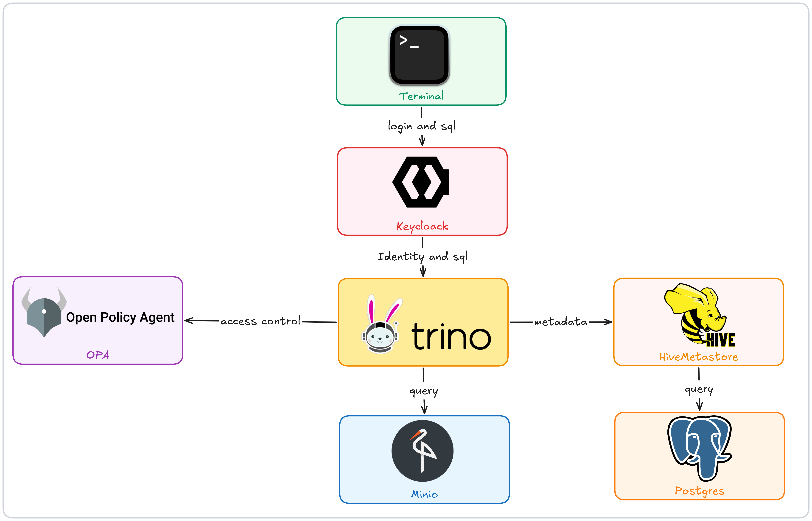
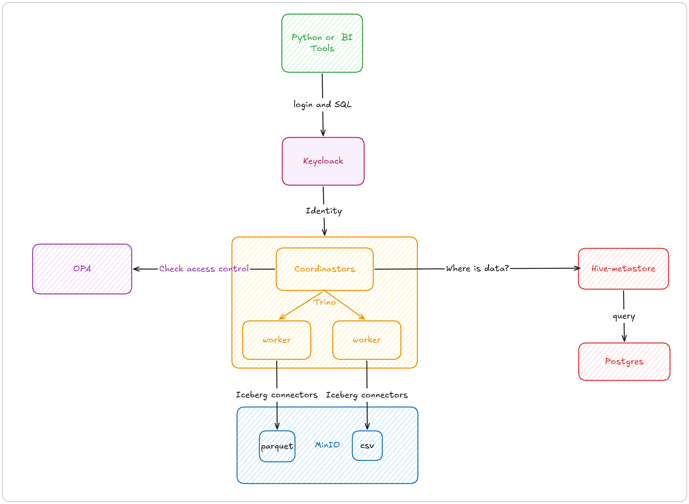
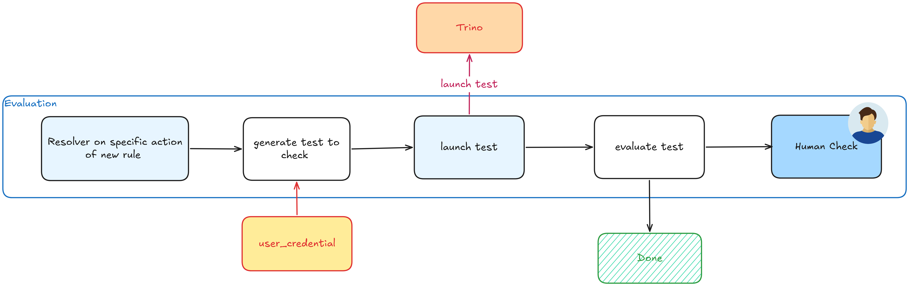
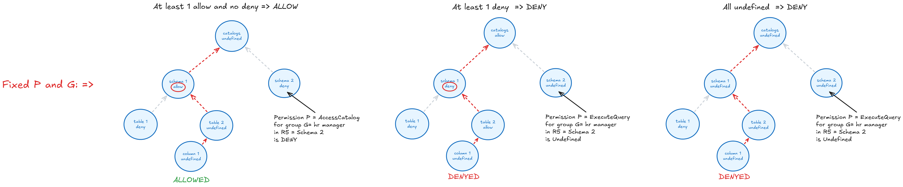
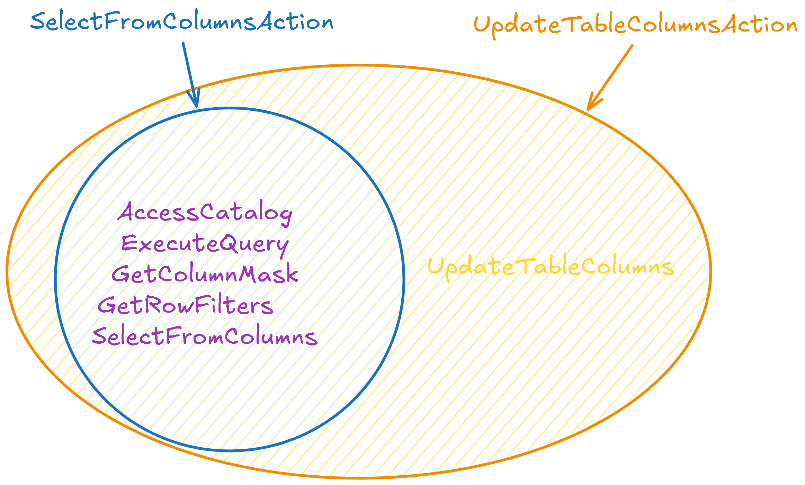
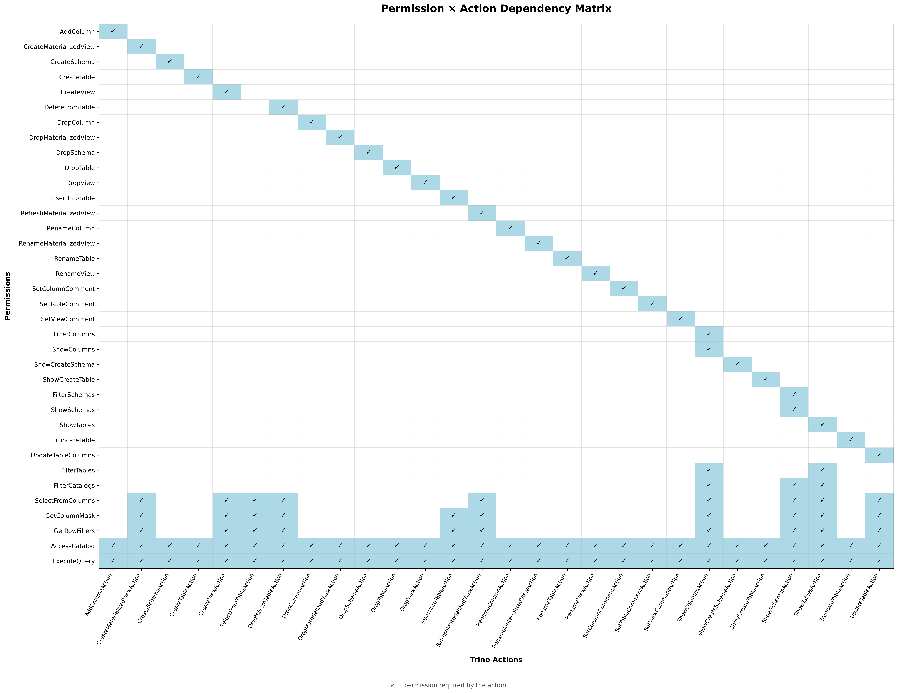
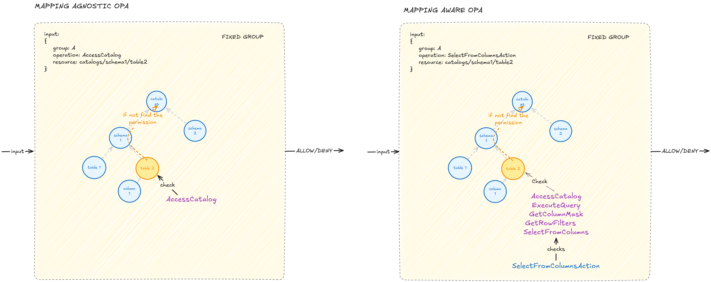
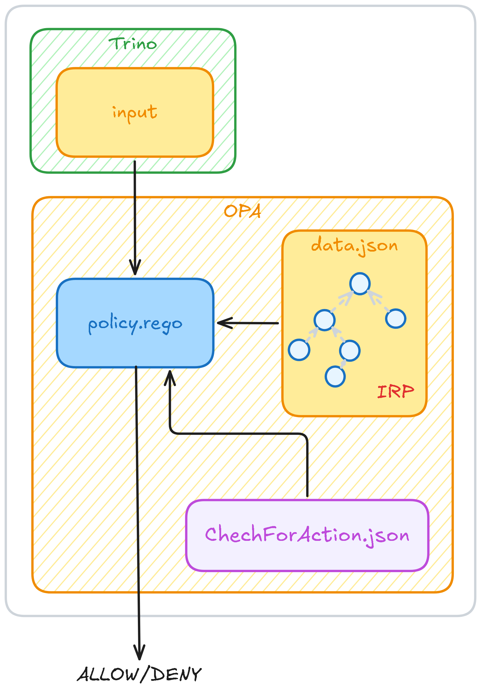
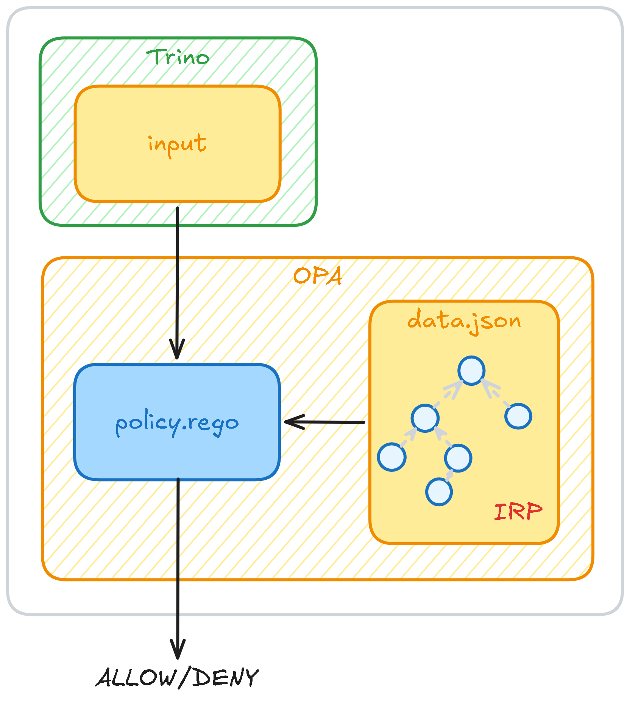
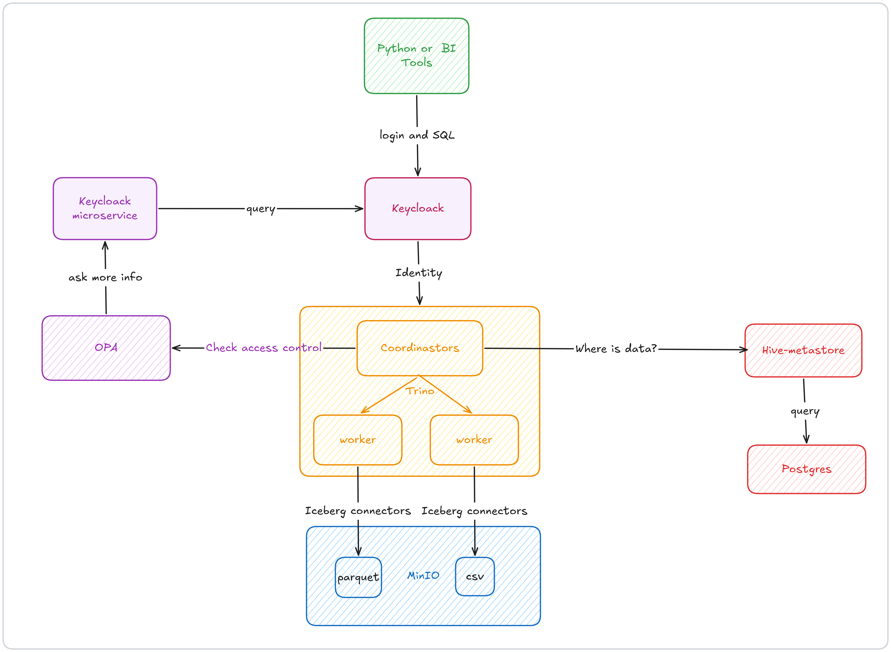

# OPA Rules Generated by an LLM, Compatible with Trino


This project contains the generation pipeline and analysis code
developed in support of a thesis in Computer Science at Politecnico di
Milano. The main goal of this project is to generate OPA rules from
natural language descriptions, using a Large Language Model (LLM) as the
core component. The generated rules are compatible with Trino, a
distributed SQL query engine.

## Project Structure

-   `Analysis/`: Contains the code for analyzing the different OPA
    configurations: mapping-aware and mapping-agnostic.
-   `Communication/`: Contains the code for communicating with Trino
    once the Docker container is running. It helps users log in and
    execute queries on the Trino server.
-   `docker-compose/`: Contains the Docker configuration for all the
    applications: Trino, OPA, Keycloak, Hive Metastore, and MinIO.
-   `Draw/`: Contains a drawing function that takes the cumulative tree,
    a security group, a permission, and a resource as input and draws
    the permission tree.
-   `Example/`: Contains examples of rules that can be sent to the LLM
    to generate rules as code inside the permission tree.
-   `Function/`: Contains functions shared across the project.
-   `Image/`: Contains the images used in this project.
-   `LLM/`: Contains all the interfaces for communicating with LLMs,
    which can be local or remote.
-   `Pipelines/`: Contains the code for generating OPA rules from
    natural language descriptions.
-   `Structure/`: Contains environmental and configuration files used to
    define what is allowed and what actually exists in the authorization
    architecture.
-   `StructureExtraction/`: Contains the executable required to populate
    the files in the `Structure/` folder.
-   `.envExample`: An example of an `.env` file.
-   `.gitattribute` and `.gitignore`: Git configuration files.
-   `check_allowed_action.py`: Asks for a rule and checks whether the
    corresponding permission is already allowed.
-   `launcher.ps1` or `launcher.sh`: Used to build the Docker Compose
    environment, launch the extraction pipelines, and start rule
    generation.
-   `orchestrator.py`: Responsible for orchestrating the generation
    pipelines.
-   `requirements.txt`: Contains all the libraries required for the
    Python virtual environment.
-   `reset_rego.py`: Cancels all previously generated rules when the
    orchestrator restarts, if necessary.

## Set Up

The project requires several Python libraries; therefore, a virtual
environment must be created.

``` bash
py -m venv .venv
.\.venv\Scripts\Activate.ps1
# install required library
python -m pip install -r requirements.txt
```

To update the list of installed libraries after adding new dependencies,
run:

``` bash
pip freeze > requirements.txt
```

Install Docker using the following link:

https://docs.docker.com/desktop/setup/install/windows-install/

### LLM

Copy and rename `.envExample` to `.env` before configuring the LLM.

#### Remote LLM

In `.env`, set `IS_LOCAL` to `false` and `OPENAI_API_KEY` to the
required API key.

#### Local LLM

The local LLM implementation uses Intel IPEX to run on an Intel ARC GPU.

Follow the instructions at the following link:

https://github.com/intel/ipex-llm/blob/main/docs/mddocs/Quickstart/llamacpp_portable_zip_gpu_quickstart.md

Any LLM supported by Hugging Face can be selected, provided that it uses
a GGUF extension.

``` bash
python.exe -m pip install --upgrade pip
pip install -U "huggingface_hub[cli]"
hf download bartowski/Qwen2.5.1-Coder-7B-Instruct-GGUF --include "Qwen2.5 1-Coder-7B-Instruct-Q4_K_M.gguf" --local-dir ./
cd llama-cpp-ipex-llm-2.3.0b20250424-win
mkdir "models"
cd ..
Move-Item "Qwen2.5.1-Coder-7B-Instruct-Q4_K_M.gguf" "models\\"
```

The embeddings model must also be downloaded.

``` bash
hf download nomic-ai/nomic-embed-text-v1.5-GGUF --include "nomic-embed-text-v1.5.f16.gguf" --local-dir ./
```

Test the LLM by launching it:

``` bash
cd llama-cpp-ipex-llm-2.3.0b20250424-win
.\llama-server.exe -m .\models\Qwen2.5.1-Coder-7B-Instruct-Q4_K_M.gguf
```

In another shell, launch an example chatbot:

``` bash
.\.venv\Scripts\Activate.ps1
python LLM/LocalLLMIntelIpex/UsefulChat/ChatBot.py
```

To configure the project to use this LLM, set the following values in
`.env`:

-   `IS_LOCAL='True'`
-   `LOCAL_CHAT_MODEL="Qwen2.5.1-Coder-7B-Instruct-Q4_K_M.gguf"` \#
    "qwen2.5-coder-14b-instruct-q4_k_m.gguf"
-   `LOCAL_EMBEDDING_MODEL="nomic-embed-text-v1.5.f16.gguf"`

## Docker Compose

The `docker-compose/` folder defines the architecture considered in this
project:



The architecture includes:

1.  **Trino:** The Policy Enforcement Point (PEP), which intercepts
    access requests and enforces the resulting authorization decisions.
2.  **OPA:** The Policy Decision Point (PDP), which evaluates
    authorization requests against the applicable policies and
    determines whether access should be granted or denied.
3.  **Keycloak:** The Policy Administration Point (PAP), which provides
    the means to define, manage, and distribute authorization policies.
4.  **Hive Metastore:** Used by Trino to determine where the data is
    stored.
5.  **MinIO:** Contains the actual Data Mesh.

### Configuration to Be Changed

The current configuration uses example data and settings.

-   The Docker configuration also allows values to be loaded into the
    Data Mesh. The `docker-compose/datasets/` folder contains examples,
    together with their loading functions in MinIO, defined in
    `docker-compose/init/`. These files define the Data Mesh structure.
-   The groups and user profiles in Keycloak can be configured by
    modifying `docker-compose/keycloak/import/trino-realm.json`.

If this information is changed, the following file must also be
modified:

`LLM/LLMPipeline/Example/Datastore/RewriteRule/rewrite_rule_examples.json`

## Launching the Generation Pipeline

Before starting, complete the following steps:

1.  Open Docker Desktop.

2.  Execute `launcher.sh` or `launcher.ps1`:

    ``` bash
    .\launcher.ps1
    # or
    bash launcher.sh
    ```

The launcher performs the following steps:

-   Builds the Docker Compose environment, starts all applications, and
    loads the required data.
-   Executes data extraction to retrieve the security groups, user
    profiles, and Data Mesh structure.
-   Runs the orchestrator.

The orchestrator then performs the following steps:

-   Prompts for confirmation before launching the tests. These tests
    should only be launched with the original Data Mesh structure.
-   Starts asking for rules to be inserted into the system.
-   Each time the LLM extracts a rule, asks the user to verify its
    correctness.
-   After a new rule has been added to the set of rules, asks whether a
    test should be run to verify the expected behavior.

The generation Pipeline managed by the orchestrator is: 


The only difference is that testing pipeline in the actual implementation is:



The human checks ends the full generation Pipeline.

The orchestrator can be launched at any time while Docker is running.

``` bash
python orchestrator.py
```

To test the system, log in using the following command:

``` bash
bash Communication/trino_session.sh --user hr --password hr123
```

Queries can then be executed.

> **Warning**
>
> There is a limitation when launching tests that modify the Data Mesh
> structure: the generated rules are not updated to reflect those
> changes.
>
> For example, if a table is renamed, the cumulative tree and the final
> `data.json` file will retain the previous table name.

## Permission Evaluation

Permissions are stored in `docker-compose/opa/data.json`. The file uses
a map structure in which the keys are resource paths, and the values are
objects mapping security groups to their allowed or denied permissions
and associated filters.

The algorithm implemented in
`docker-compose/opa/permission_resolver.rego` reads `data.json` as a
permission tree and evaluates whether a permission is allowed.

The evaluation considers the path between the target resource and `ROOT`
(the main MinIO folder), together with the security group of the user
making the request.

Permissions are evaluated according to the following rules:

-   If a permission is neither explicitly allowed nor denied anywhere
    along the path, the default result is **deny**.
-   If at least one denial exists, the permission is denied accordingly.
-   If there are no denials and at least one allow declaration exists,
    the permission is allowed.



## Analysis

A limitation of the current implementation is described in the thesis:
Trino acts as a mapping-aware Policy Enforcement Point (PEP), while OPA
acts as a mapping-agnostic Policy Decision Point (PDP).

The PEP receives the action, knows the mapping between actions and
permissions, and sends a separate request to the PDP for each required
permission. The PDP evaluates whether each permission is allowed, and
the resulting permission checks determine whether the action can
proceed.

The main limitation concerns the negation of actions. To deny an action,
it is necessary to deny at least one of its required permissions.
However, some actions do not have any permissions that are exclusive to
them. Consequently, denying a shared permission can also block other
actions that require the same permission.



In particular full mapping is:



The proposed solution is to switch to a mapping-agnostic PEP and a
mapping-aware PDP configuration. In this configuration, the mapping is
moved into OPA, which receives the action and iterates over its required
permissions to verify whether they are allowed.




To support action-specific denial, the action name can be added to a
list of denied actions in the permission tree, or an exclusive
permission can be introduced where necessary.

The analysis considers three configurations:

-   Mapping-aware OPA: `Analysis/docker-opa-mapping-aware`
-   Mapping-agnostic OPA: `Analysis/docker-opa-mapping-agnostic`
-   Default-allow OPA: `Analysis/docker-opa-default-allow`

Both the mapping-aware and mapping-agnostic configurations use the same
`Analysis/data.json` file, which is copied into the Docker volumes.

Mapping-aware has also `Analysis/docker-opa-mapping-aware/opa/checkForAction.json` which contains the mapping.



While mapping-agnostic is simply:



When `Analysis/analyzer.py` is launched, it executes semi-randomly
generated tests. The `benchmark_cleaned.py` script generates the
analysis graphs.

# PIP: keycloack microservice

The microservice is active but never used. OPA should call it using a
call like:

``` rego
user_info := resp.body if {
    print("input user:", input.context.identity.user)
    resp := http.send({
        "method": "GET",
        "url": sprintf("http://keycloak-microservice:5000/users/%s", [input.context.identity.user]),
        "raise_error": false
    })

    resp.status_code == 200
}
user_hr if {
    user_info
    groups := object.get(user_info, "groups", [])
    "hr_manager" in groups
}

allow if {
    print("Before HTTP")

    x := user_info

    print("After HTTP:", x)

    false
}
```

This HTTP request will give more information about the user, to extend
the access control algorithm to an attribute base access control. The
final structure will be like:


